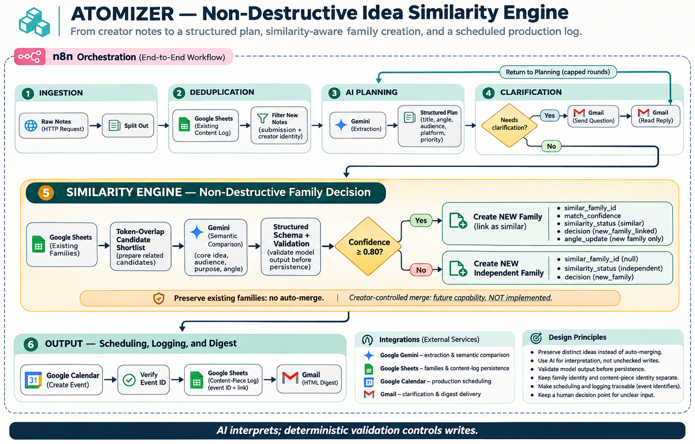

# Atomizer

Atomizer is an n8n workflow for turning unstructured creator notes into a structured, scheduled content plan.

It combines deterministic workflow logic with Gemini-assisted extraction and semantic similarity checks. The workflow is designed to preserve distinct content angles instead of silently merging ideas that happen to cover the same broad topic.

## What it does

1. Receives creator notes from an HTTP source.
2. Splits a batch into individual submissions and filters repeated submissions.
3. Extracts a structured content plan with Gemini.
4. Pauses for creator clarification when required.
5. Compares the new idea with existing content families.
6. Uses semantic similarity scoring to flag related ideas.
7. Creates a new family proposal with a reference to the closest existing family instead of overwriting it.
8. Persists family and content-piece records in Google Sheets.
9. Creates production events in Google Calendar.
10. Sends a digest through Gmail.

## Why it matters

Content planning often starts as scattered notes and becomes difficult to organize as ideas multiply. Atomizer makes the planning process repeatable while keeping a human in the loop for ambiguity and review.

The central design choice is non-destructive similarity handling: a related idea is flagged and given a new family identifier, rather than being merged into an existing family automatically.

## Team

| Team member | Role | Contribution |
| --- | --- | --- |
| Alex Rivera | AI Automation and Integration Engineer | Built the AI clarification logic, led the main n8n workflow integration, supported final validation, and created the pitch presentation. |
| Jordan Lee | Workflow and Data Automation Engineer | Developed the non-destructive similarity engine, worked on the Sheets and Calendar pipeline, organized the n8n nodes, and tested data integrity. |
| Sam Patel | AI Communication Automation Developer | Worked on the Gmail digest and creator communication, improved email formatting, and collaborated on the clarification flow. |

Names above are placeholders and should be replaced with the teammates' preferred names before final portfolio use.

## Architecture

```text
HTTP notes
    -> split and de-duplicate
    -> Gemini content extraction
    -> clarification loop when needed
    -> existing-family lookup
    -> keyword candidate preparation
    -> Gemini semantic comparison
    -> validation and family decision
    -> guarded family persistence
    -> content-piece generation
    -> Calendar scheduling
    -> Sheet logging
    -> Gmail digest
```



The diagram summarizes the end-to-end flow, including the non-destructive similarity decision and the external service boundaries.

The workflow contains 43 nodes in the supplied export, including HTTP, Gemini, Google Sheets, Google Calendar, Gmail, code, branching, merge, loop, and structured-output nodes.

See the detailed documentation:

- [Architecture and design](docs/architecture.md)
- [Workflow reference](docs/workflow-reference.md)
- [Evidence, scope, and limitations](docs/evidence-and-limitations.md)
- [Safe publication checklist](docs/publication-checklist.md)
- [Contributing](CONTRIBUTING.md)
- [Security](SECURITY.md)

## Repository structure

```text
.
├── README.md
├── CONTRIBUTING.md
├── SECURITY.md
├── docs/                 # Public project documentation
├── assets/               # Sanitized media only
└── private/              # Local evidence and raw exports, ignored by Git
    ├── data/
    ├── evidence/
    ├── reference/
    └── workflows/
```

The `private/` directory is retained locally for traceability but is intentionally excluded from publication. Add sanitized workflow examples and reviewed media under `assets/` only after completing the publication checklist.

## Important status note

The supplied workflow export is configured but not sufficient to claim a fully validated production deployment. It is inactive and uses a manual trigger in the export. The repository should present this as a portfolio prototype or buildathon workflow unless fresh end-to-end execution evidence is added.

## Privacy and configuration

Do not publish the raw workflow export or spreadsheet snapshot without sanitizing them. The supplied artifacts contain service identifiers, a webhook URL, credential references, email addresses, calendar identifiers, spreadsheet identifiers, event links, and sample creator data.

Use placeholders and environment-specific credentials in the public repository. Keep operational exports and real data outside version control.

## License

No license has been selected yet. Choose a license before making the repository public.
